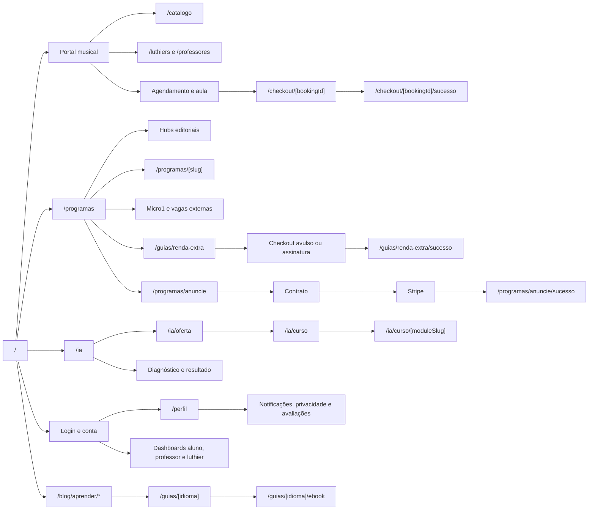

# Mapa de páginas e checklist de publicação

Use este documento para verificar cada rota antes do upload/deploy. Marque uma
rota somente depois de testar carregamento, navegação, mobile, links, estados de
erro e, quando aplicável, autenticação ou checkout.

## Fluxo visual

## 1. Entrada, navegação e páginas institucionais

- [ ] `/`
- [ ] `/login`
- [ ] `/registro`
- [ ] `/contatos`
- [ ] `/contatos/ganhar-dinheiro`
- [ ] `/privacidade`
- [ ] `/termos`
- [ ] `/reembolso`
- [ ] `/noticias`
- [ ] `/noticias/anunciar`
- [ ] `/mural-de-parceiros`

Verificar: cabeçalho, menu mobile, rodapé, consentimento, links externos,
favicon, título, descrição, canonical e comportamento sem JavaScript.

## 2. Área musical pública

- [ ] `/catalogo`
- [ ] `/catalogo/[id]` — testar um ID válido e um inexistente
- [ ] `/comparar`
- [ ] `/guia-de-cordas`
- [ ] `/clinica`
- [ ] `/fisica-do-som`
- [ ] `/meu-setup`
- [ ] `/luthiers`
- [ ] `/luthiers/[id]` — testar um perfil válido e um inexistente
- [ ] `/professores`
- [ ] `/professores/[id]` — testar um perfil válido e um inexistente
- [ ] `/lojas`
- [ ] `/recomendados`
- [ ] `/importacao`
- [ ] `/aluno`

Verificar: busca, filtros, cards, imagens, links de contato, estados vazios,
responsividade, teclado e ausência de dados sensíveis no HTML público.

## 3. Agendamento e pagamentos de aulas

- [ ] `/checkout/[bookingId]` — booking pendente
- [ ] `/checkout/[bookingId]` — booking pago ou inexistente
- [ ] `/checkout/[bookingId]/sucesso`
- [ ] `/dashboard/aluno`
- [ ] `/dashboard/professor`
- [ ] `/dashboard/luthier`
- [ ] `/dashboard/luthier/planos`

Verificar: usuário correto, booking de outro usuário, botão Stripe, cancelamento,
retorno de sucesso, sala Daily, notificações e atualização via webhook.

## 4. Catálogo de Renda Extra

- [ ] `/programas`
- [ ] `/programas/[slug]` — testar oportunidade publicada
- [ ] `/programas/[slug]` — testar slug inexistente
- [ ] `/programas/iniciantes`
- [ ] `/programas/dolar`
- [ ] `/programas/celular`
- [ ] `/programas/sem-investimento`
- [ ] `/programas/trabalho-remoto`
- [ ] `/programas/pesquisas-remuneradas`
- [ ] `/programas/micro1`
- [ ] `/programas/notificacoes`
- [ ] `/programas/admin` — somente administrador
- [ ] `/blog/renda-extra` — alias/canonical para `/programas`

Verificar: filtros, paginação, Micro1, links de afiliado, disclosure, salvar,
compartilhar, lembrete, modal, estados de API externa e links específicos de
projetos. Nunca validar remuneração como garantia.

## 5. Guia de Renda Extra e anúncios

- [ ] `/guias/renda-extra`
- [ ] `/guias/renda-extra/sucesso`
- [ ] `/programas/anuncie`
- [ ] `/programas/anuncie/contrato`
- [ ] `/programas/anuncie/sucesso`
- [ ] `/anuncie` — legado/redirecionamento
- [ ] `/anuncie/contrato`
- [ ] `/anuncie/sucesso`

Verificar: formulário, consentimento, CPF, checkout avulso, assinatura, acesso
convidado, download protegido, retorno sem pagamento, cotas, contrato, upload
do criativo, aprovação manual e bloqueio de campanha inválida.

## 6. Idiomas e e-books

### Conteúdo gratuito

- [ ] `/blog/aprender/ingles`
- [ ] `/blog/aprender/italiano`
- [ ] `/blog/aprender/frances`
- [ ] `/blog/aprender/alemao`
- [ ] `/blog/aprender/espanhol`
- [ ] `/blog/aprender/chines`

### Guias e e-books pagos

- [ ] `/guias/ingles`
- [ ] `/guias/ingles/ebook`
- [ ] `/guias/italiano`
- [ ] `/guias/italiano/ebook`
- [ ] `/guias/frances`
- [ ] `/guias/frances/ebook`
- [ ] `/guias/alemao`
- [ ] `/guias/alemao/ebook`
- [ ] `/guias/espanhol`
- [ ] `/guias/espanhol/ebook`
- [ ] `/guias/chines`
- [ ] `/guias/chines/ebook`

Verificar: idioma correto, navegação entre idiomas, preview, compra, entrega do
arquivo correto, personalização, impressão, mobile e SEO.

## 7. IA, quiz e diagnóstico

- [ ] `/ia`
- [ ] `/ia/oferta`
- [ ] `/ia/curso`
- [ ] `/ia/curso/[moduleSlug]` — módulo válido e inválido
- [ ] `/ia/ferramentas`
- [ ] `/ia/prompts`
- [ ] `/ia/progresso`
- [ ] `/ia/resultado`
- [ ] `/quiz-negocios`
- [ ] `/resultado`

Verificar: estado sem login, progresso, respostas persistidas, resultado,
limites de acesso, CTA de compra, reduced motion e mensagens de erro.

## 8. Conta, perfil e superfícies privadas

- [ ] `/perfil`
- [ ] `/perfil/avaliacoes`
- [ ] `/perfil/notificacoes`
- [ ] `/perfil/privacidade`
- [ ] `/programas/notificacoes`
- [ ] `/admin`

Verificar: acesso sem sessão, autorização por papel, logout, troca de senha,
dados de outro usuário, exclusão/privacidade, notificações e ações administrativas.

## 9. Rotas técnicas obrigatórias antes do upload

Estas rotas não são páginas, mas devem ser verificadas porque sustentam os fluxos:

- [ ] `/api/health`
- [ ] `/api/health/config`
- [ ] `/api/payments/create-booking-payment`
- [ ] `/api/payments/create-guide-checkout`
- [ ] `/api/payments/create-guide-subscription`
- [ ] `/api/payments/create-ad-subscription`
- [ ] `/api/payments/stripe-webhook`
- [ ] `/api/payments/guide-status`
- [ ] `/api/payments/guide-access/recover`
- [ ] `/api/downloads/guide`
- [ ] `/api/materials`
- [ ] `/api/ads/click`
- [ ] `/api/ads/material`
- [ ] `/api/sales/verify-offer`
- [ ] `/api/sales/offer-events`
- [ ] `/api/auth/change-password`
- [ ] `/api/video/room`
- [ ] `/api/notifications/push/config`
- [ ] `/api/notifications/push/subscribe`
- [ ] `/api/notifications/push/unsubscribe`
- [ ] `/api/cron/sync-subscriptions`
- [ ] `/api/webhooks/gateway`
- [ ] `/auth/callback`
- [ ] `/robots.txt`
- [ ] `/sitemap.xml`
- [ ] `/manifest.webmanifest`
- [ ] `/programas/manifest.webmanifest`
- [ ] `/blog/renda-extra/manifest.webmanifest`

## Critério de aprovação por página

Para marcar uma rota como pronta:

1. Abrir em produção ou preview sem erro no console.
2. Testar desktop e viewport de 390px.
3. Testar navegação por teclado e foco visível.
4. Conferir links, imagens, textos e botões.
5. Testar estado vazio, erro e rota inexistente quando aplicável.
6. Confirmar título, descrição e canonical.
7. Confirmar que nenhum segredo, CPF ou token aparece no HTML, URL ou log.
8. Registrar a data, ambiente, responsável e observação.

## Ordem recomendada de upload

1. Variáveis de ambiente e domínio.
2. Banco/migrations já aprovadas.
3. Storage privado dos materiais.
4. Webhook Stripe.
5. Rotas técnicas de saúde.
6. Páginas públicas.
7. Autenticação e páginas privadas.
8. Checkouts em modo de teste.
9. E-mails, downloads e notificações.
10. Smoke test final e publicação.
